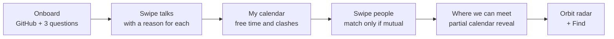
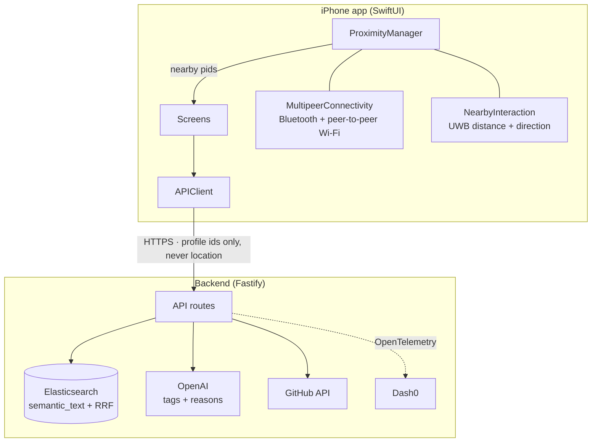
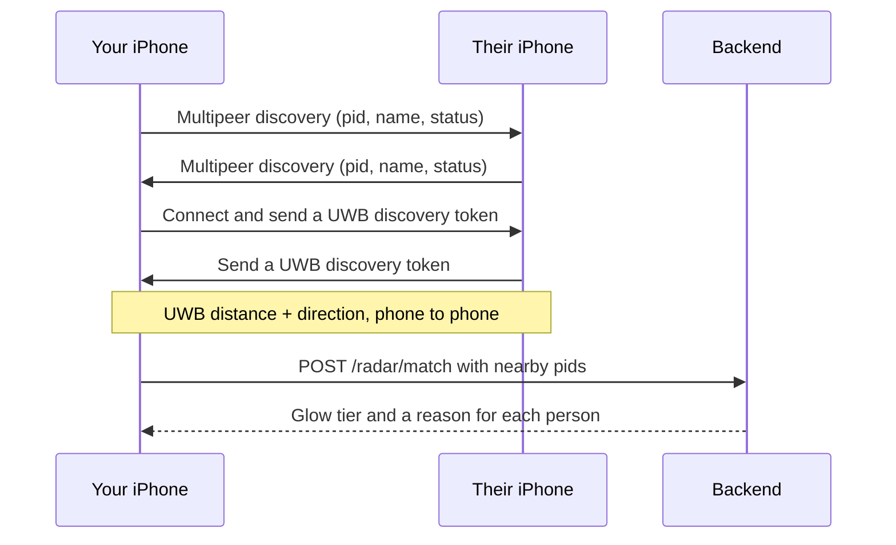

<p align="center">
  
</p>

<p align="center">
  
  
  
  
  
  
</p>

<h3 align="center"><em>"Today you walked past 50 people who could have changed your career.<br>You'll never know who they were."</em></h3>

---

**Orbit** is an iPhone app for conferences. Swipe to build your schedule, get matched with people who need what you offer (and offer what you need), see when and where you can meet, and when they're **physically near you**, Orbit shows them on a live radar and points the way.

Built in one day at the **WeMakeDevs Cloud Native Hackathon**, Salt Lake City, during KubeCon NA 2026.

## The problem

| | |
|---|---|
| 🤝 **Networking is why people come** | About half of attendees say successful networking is the top reason they return ([Freeman, 2025](https://www.pcma.org/why-your-approach-to-networking-is-not-meeting-attendees-needs/)) |
| 😬 **…and it's awkward** | 31% find networking awkward, and about a quarter say they're bad at starting conversations ([Freeman, 2025](https://www.pcma.org/why-your-approach-to-networking-is-not-meeting-attendees-needs/)) |
| 🆕 **KubeCon is full of strangers** | 9,388 attendees, **50% first-timers**, 409 sessions at KubeCon NA 2025 ([CNCF transparency report](https://www.cncf.io/wp-content/uploads/2025/12/KCNA25_TransparencyReport.pdf)) |
| 📋 **Apps give you lists** | Sched gives you hundreds of talks; attendee apps give you thousands of names. None of them tell you **who you should meet, when you're both free, or that they're 4 meters away right now** |

Proximity apps (Highlight, Banjo) died from **cold start** and **creepiness**. A conference fixes the cold start: everyone is in one building to meet strangers. Our design fixes the creepiness: **location never leaves your phone**.

## What it does



1. **Onboard in under a minute.** Your GitHub username plus three questions: *what are you working on, what are you looking for, what could you help someone with?* The backend turns that into topic tags, which you can review and edit.
2. **Swipe talks.** Every card says why it fits *you*: right to save, up for must-attend. The deck learns from your swipes.
3. **My calendar.** Saved talks, free gaps and clashes, and one tap to add everything to the iPhone Calendar.
4. **Swipe people.** Matching works both ways: a pair only scores high if **each** person has something the other needs.
5. **Where we can meet.** After a mutual match you see only the **overlap** of your calendars: talks you're both attending, times you're both free, and suggested meetups.
6. **📡 Orbit radar.** People physically near you appear as dots. Your matches glow, and tapping a dot shows why you should talk.

<p align="center">
  
</p>

## How it works



### Proximity: phone to phone, no GPS



- **MultipeerConnectivity** finds nearby iPhones running Orbit, the same way AirDrop does. It doesn't need a shared Wi-Fi network.
- **NearbyInteraction** uses the Ultra Wideband chip (iPhone 11 and newer, except SE) for precise distance and, on supported models, direction. Other phones fall back to distance only, or "nearby".
- The backend only ever receives **profile ids**. It never knows where anyone is.

### Matching with Elasticsearch

Elastic is the whole data layer: profiles, talks, swipes, matches and meetups.

- **Talks:** an **RRF** retriever fuses a `semantic` query (Jina embeddings via `semantic_text`) with lexical matching on topics, titles and abstracts. The query text includes the titles of your last saved talks, so the deck adapts as you swipe.
- **People:** reciprocal scoring.

```text
need_offer   = sqrt( sim(my looking_for, their offering) · sim(their looking_for, my offering) )
interests    = 0.5 · jaccard(topics) + 0.5 · sim(working_on)
talk_overlap = shared saved talks / min(4, my saved talks)
score        = 0.45·need_offer + 0.30·interests + 0.25·talk_overlap   (+0.10 if goals complement)
```

The geometric mean in `need_offer` means a pair only scores high when **both** people benefit. Results are diversified with MMR. Details are in [`backend/README.md`](backend/README.md).

### Observability with Dash0

OpenTelemetry auto-instruments HTTP, Fastify and the Elastic client. There are manual spans for `profile.build`, `github.fetch`, `openai.*`, `elastic.talks.hybrid`, `elastic.people.score` and `orbit.meet.view`, plus metrics for swipes, matches and LLM latency. Everything is exported to Dash0.

## Privacy and consent

| Data | Who sees it |
|---|---|
| Profile (role, topics, what you're working on) | Everyone at the event, unless you're 🔴 |
| Your saved talks | Only you. Mutual matches see **only the talks you both saved** |
| Your free time | Only mutual matches, and only the **overlap** with their own free time |
| Your next planned room | Only mutual matches. Turn it off with "Hide where I'll be" |
| Live proximity | **Never leaves the phone.** Computed between the two phones only |

- **🟢 Open to chat · 🟡 Ask first · 🔴 Invisible.** Red stops broadcasting immediately, so you vanish from every radar.
- **🟡 Ask first** lets people who find approaching strangers hard (introverts, neurodivergent attendees, anyone tired) stay discoverable on their own terms.
- You're visible only while the app is open. All data is deleted after the event.
- Accessibility: VoiceOver labels on every radar dot ("Priya, your match, about 3 meters, to your right"), a list view as an alternative to the radar, and buttons as an alternative to swiping.

## Sponsor tracks

| Track | How Orbit uses it |
|---|---|
| **Elasticsearch: Find the Right Talk** | The whole data layer: hybrid talk search with RRF and swipe feedback, reciprocal people matching, schedules and meetups |
| **Dash0: Stop Flying Blind** | OpenTelemetry traces and metrics across the API, Elastic and LLM calls |
| **Merge Forward: Conferences for Everyone** | Consent-first proximity, partial calendar reveal, 🟡 Ask first, VoiceOver support |
| **Best overall** | The full journey: swipe → calendar → match → meet → live radar → Find |

## Run it

### Backend

```bash
cd backend
npm install
npm run seed     # creates the indices, loads 48 talks + 20 fictional personas
npm run dev      # http://localhost:8080
```

Environment variables (Elastic, OpenAI, Dash0) are listed in [`backend/README.md`](backend/README.md).

### iOS app

1. Open `ios/Orbit.xcodeproj` in Xcode 16. The first time, Xcode needs the iOS platform: **Settings → Components → iOS → Get**.
2. Target **Orbit** → Signing & Capabilities → choose your Team (a free Apple ID works).
3. Run on an iPhone with Developer Mode on (Settings → Privacy & Security → Developer Mode).

The app starts in **stub mode** with bundled sample data, so every screen works without a backend. To connect it, tap the **gear icon** → set the backend URL → turn off **Use stub data**. In the Simulator, the radar shows **demo people**; on real iPhones it finds real phones. Switch between the two from the radar menu.

Testing the radar for real needs **two iPhones**, both running Orbit, with Bluetooth and Wi-Fi on. See [`ios/README.md`](ios/README.md).

## Repo layout

```text
ios/                    SwiftUI app
  Orbit/App/            entry point, app state, developer settings
  Orbit/Core/           API models, APIClient, stub JSON
  Orbit/Onboarding/     profile + tag review
  Orbit/Radar/          proximity engine, radar, person card, Find
  Orbit/Talks|Calendar|People|Matches/   swipe decks, calendar, matches
backend/                Fastify + TypeScript API (Elastic, OpenAI, OpenTelemetry)
data/                   fictional talks, personas and meeting spots
assets/                 README graphics
PLAN.md                 build plan
```

All talks and personas in `data/` are **fictional**. They are not real KubeCon sessions or attendees.

## Team

| | Built |
|---|---|
| **Jenish Kothari** ([@jenishk20](https://github.com/jenishk20)) | iOS app core, Orbit radar, proximity engine |
| **Arjun** ([@Arjunprasaath](https://github.com/Arjunprasaath)) | Backend, Elasticsearch matching, observability |
| **TODO: name** | iOS swipe decks, calendar, matches |

## AI-assistant disclosure

As the hackathon rules require, we disclose that we used AI coding assistants. **Claude Code** helped write parts of the iOS app (project setup, API client, proximity engine, radar) and this README. **TODO: list any other tools used, e.g. for the backend.** Every team member reviewed the code in their area and can explain the architecture and the technical decisions behind it.
