<p align="center">
  
</p>

<p align="center">
  
  
  
  
  
  
</p>

<h3 align="center"><em>"Today you walked past 50 people who could have changed your career.<br>You'll never know who they were."</em></h3>

---

**Affinity** is an iPhone app for conferences:
1. **Swipe** through talks, and your schedule builds itself.
2. **Match** with people who need what you offer, and offer what you need.
3. **See** only the overlap of your calendars: when and where you can meet.
4. When they're **physically near you**, Affinity puts them on a live radar and points the way.

Built in one day at the **WeMakeDevs Cloud Native Hackathon**, Salt Lake City, during KubeCon NA 2026.

## The problem

| | |
|---|---|
| 🤝 **Networking is why people come** | About half of attendees say successful networking is the top reason they return ([Freeman, 2025](https://www.pcma.org/why-your-approach-to-networking-is-not-meeting-attendees-needs/)) |
| 😬 **…and it's awkward** | 31% find networking awkward, and about a quarter say they're bad at starting conversations ([Freeman, 2025](https://www.pcma.org/why-your-approach-to-networking-is-not-meeting-attendees-needs/)) |
| 🆕 **KubeCon is full of strangers** | 9,388 attendees, **50% first-timers**, 409 sessions at KubeCon NA 2025 ([CNCF transparency report](https://www.cncf.io/wp-content/uploads/2025/12/KCNA25_TransparencyReport.pdf)) |
| 📋 **Apps give you lists** | Hundreds of talks, thousands of names. Nothing tells you **who to meet, when you're both free, or that they're 4 meters away right now** |

Proximity apps like Highlight and Banjo died for two reasons:
- **Cold start:** nobody near you uses the app. A conference fixes that, because everyone is in one building to meet strangers.
- **Creepiness:** strangers knowing where you are. Our design fixes that, because **your location never leaves your phone**.

## The journey

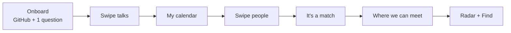

<table>
  <tr>
    <td align="center" width="25%">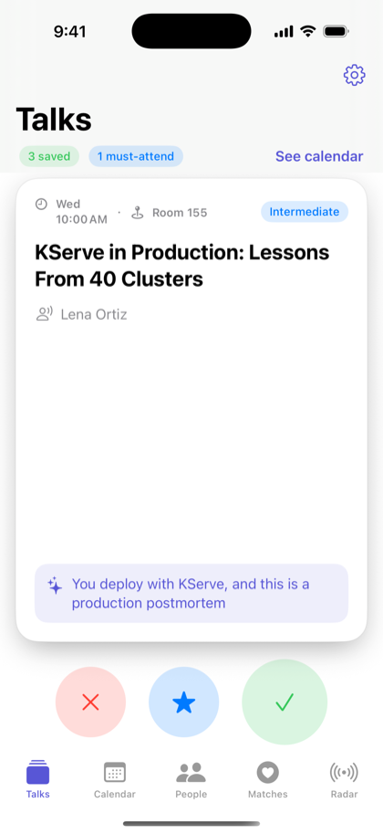<br><b>Swipe talks</b><br><sub>Each card says why it fits you</sub></td>
    <td align="center" width="25%">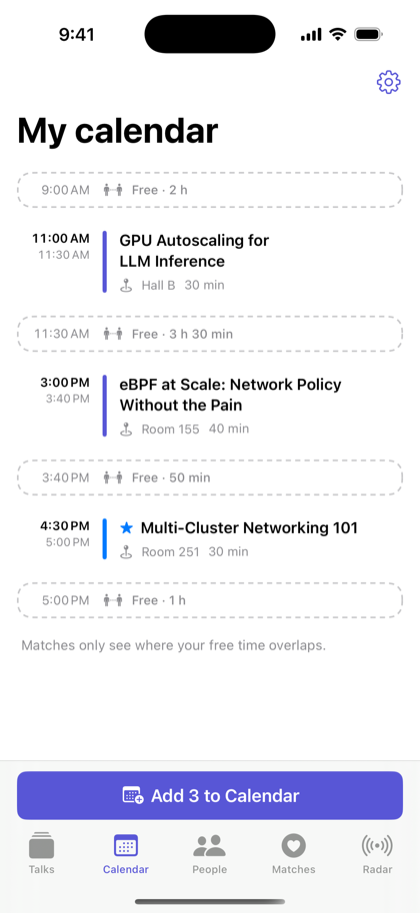<br><b>Your calendar</b><br><sub>Free gaps and clashes, worked out for you</sub></td>
    <td align="center" width="25%">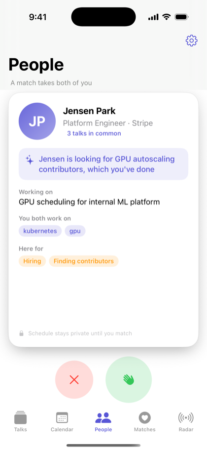<br><b>Swipe people</b><br><sub>Matched on what you need and offer</sub></td>
    <td align="center" width="25%">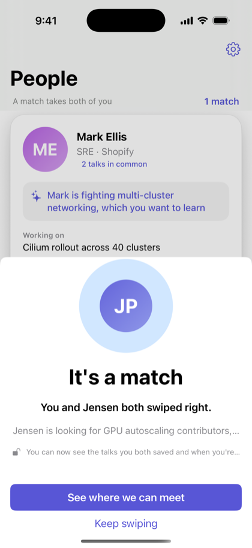<br><b>It's a match</b><br><sub>Only when you both swipe right</sub></td>
  </tr>
  <tr>
    <td align="center">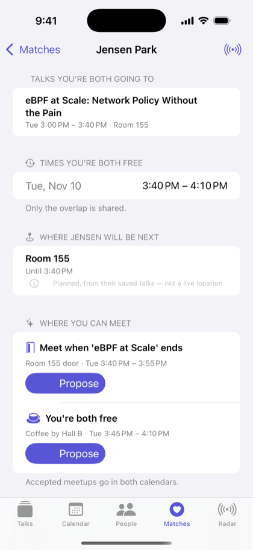<br><b>Where we can meet</b><br><sub>Only the overlap is shared</sub></td>
    <td align="center">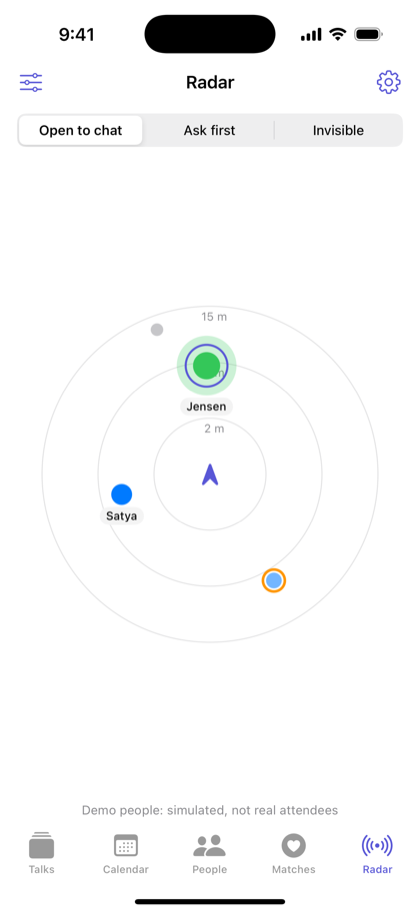<br><b>Affinity radar</b><br><sub>Who's near you right now</sub></td>
    <td align="center">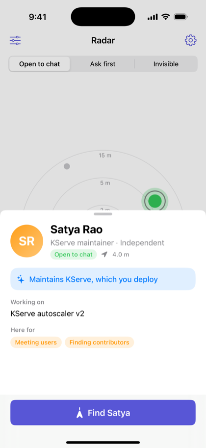<br><b>Who they are</b><br><sub>One tap on a dot</sub></td>
    <td align="center">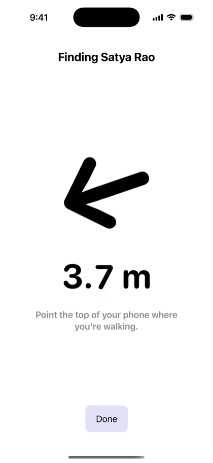<br><b>Find</b><br><sub>Arrow + live distance</sub></td>
  </tr>
</table>

### Swipe → your calendar builds itself

<p align="center">
  
</p>

- **✓ save · ★ must-attend · ✕ skip.** Swipe or tap. Every card carries a one-line reason it fits *you*.
- The deck learns from your swipes, and never shows you the same talk twice.
- **My calendar** shows your saved talks, free gaps and clashes, with **"keep this one"** to resolve a clash. **Add to Calendar** writes it all to the iPhone Calendar.

### Match → see only the overlap

<p align="center">
  
</p>

- Matching is **reciprocal**: a pair only scores high if **each** person has something the other needs.
- After a mutual match, you see **talks you're both going to**, **times you're both free**, and **where they'll be next** (labeled *planned*, never live).
- **Propose** a meetup ("Room 155 door when the talk ends"). Once they accept, it's in both calendars.

### Radar → walk over

<p align="center">
  
</p>

- People **physically near you** appear as dots on 2 m / 5 m / 15 m rings. Your **match glows green**, strong matches show in blue, and 🟡 "ask first" people get an orange ring.
- Tap a dot to see **who they are and why you'd click**. Tap **Find** for an AirTag-style arrow and live distance; the screen turns green when you're there.
- Profile photos come from **GitHub** (`github.com/<username>.png`), so nobody has to upload one. Without GitHub, people get colored initials.

## How it works

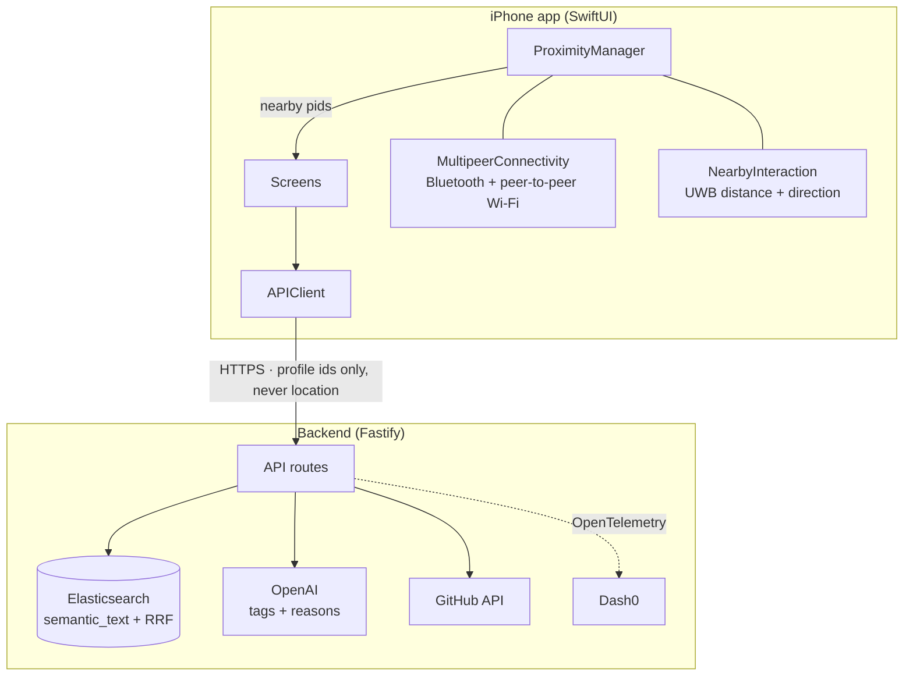

### Proximity: phone to phone, no GPS

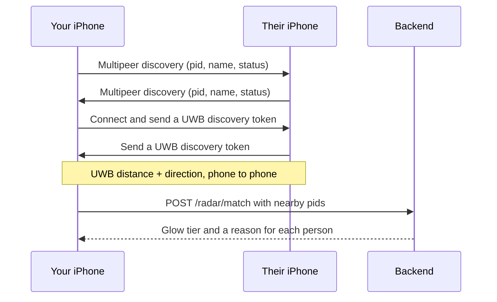

- **MultipeerConnectivity** finds nearby iPhones running Affinity the way AirDrop does, with no shared Wi-Fi needed.
- **NearbyInteraction** uses the Ultra Wideband chip (iPhone 11 and newer, except SE) for precise distance and, on supported models, direction. Other phones fall back to distance only, or "nearby".
- The backend only ever receives **profile ids**. It never knows where anyone is.

### Matching with Elasticsearch

Elastic is the whole data layer: profiles, talks, swipes, matches and meetups.

- **Talks:** an **RRF** retriever fuses a `semantic` query (Jina embeddings via `semantic_text`) with lexical matching on topics, titles and abstracts. The query includes your recently saved talks, so the deck adapts as you swipe.
- **People:** reciprocal scoring, diversified with MMR.

```text
need_offer   = sqrt( sim(my looking_for, their offering) · sim(their looking_for, my offering) )
interests    = 0.5 · jaccard(topics) + 0.5 · sim(working_on)
talk_overlap = shared saved talks / min(4, my saved talks)
score        = 0.45·need_offer + 0.30·interests + 0.25·talk_overlap   (+0.10 if goals complement)
```

The geometric mean in `need_offer` is what makes it reciprocal: a pair only scores high when **both** people benefit. More in [`backend/README.md`](backend/README.md).

### Observability with Dash0

OpenTelemetry auto-instruments HTTP, Fastify and the Elastic client, with manual spans for `profile.build`, `github.fetch`, `openai.*`, `elastic.talks.hybrid`, `elastic.people.score` and `orbit.meet.view`, plus metrics for swipes, matches and LLM latency. Everything goes to Dash0.

## Privacy and consent

| Data | Who sees it |
|---|---|
| Profile (role, topics, what you're working on) | Everyone at the event, unless you're 🔴 |
| Your saved talks | Only you. Mutual matches see **only the talks you both saved** |
| Your free time | Only mutual matches, and only the **overlap** with their free time |
| Your next planned room | Only mutual matches. Turn it off with "Hide where I'll be" |
| Live proximity | **Never leaves the phone.** Computed between the two phones only |

- **🟢 Open to chat · 🟡 Ask first · 🔴 Invisible.** Red stops broadcasting instantly, so you vanish from every radar.
- **🟡 Ask first** keeps people who find approaching strangers hard (introverts, neurodivergent attendees, anyone tired) discoverable on their own terms.
- You're visible only while the app is open. All data is deleted after the event.
- **Accessibility:**
  - VoiceOver labels on every radar dot ("Jensen, your match, about 3 meters, to your right").
  - A list view as an alternative to the radar.
  - Buttons as an alternative to swiping.

## Sponsor tracks

| Track | How Affinity uses it |
|---|---|
| **Elasticsearch: Find the Right Talk** | The whole data layer: hybrid talk search with RRF and swipe feedback, reciprocal people matching, schedules and meetups |
| **Dash0: Stop Flying Blind** | OpenTelemetry traces and metrics across the API, Elastic and LLM calls |
| **Merge Forward: Conferences for Everyone** | Consent-first proximity, partial calendar reveal, 🟡 Ask first, VoiceOver support |
| **Best overall** | The full journey: swipe → calendar → match → meet → live radar → Find |

## Run it

### Backend

```bash
cd backend
npm install
npm run seed     # creates the indices, loads 48 talks + fictional personas
npm run dev      # http://localhost:8080
```

Environment variables (Elastic, OpenAI, Dash0) are in [`backend/README.md`](backend/README.md).

### iOS app

1. Open `ios/Orbit.xcodeproj`. On macOS Tahoe, use an Xcode version that supports your macOS release; Xcode 16.4 won't open there.
2. Target **Orbit** → Signing & Capabilities → choose your Team. A free Apple ID works.
3. Run on an iPhone with Developer Mode on (Settings → Privacy & Security → Developer Mode), or in the Simulator.

### Demo mode (no backend needed)

| What you get | How |
|---|---|
| Every screen works with bundled sample data | **Stub mode** is on by default |
| Skip onboarding | Tap **Use the demo profile** |
| Talks you swipe show up in **My calendar**, with clashes and free time | Automatic. Resets when the app restarts |
| Swiping right on a person always matches | Rehearses the match → meet flow |
| Simulated people move on the radar (Jensen walks toward you and back) | **Demo people** (radar menu). On by default in the Simulator |
| Use the live backend instead | **Gear icon** → set the URL → turn off **Use stub data** |

To test the radar for real you need **two iPhones** running Affinity, with Bluetooth and Wi-Fi on and **Demo people** off. See [`ios/README.md`](ios/README.md).

## Repo layout

```text
ios/                    SwiftUI app
  Orbit/App/            entry point, app state, developer settings
  Orbit/Core/           API models, APIClient, demo-mode schedule, stub JSON
  Orbit/Onboarding/     profile + tag review
  Orbit/Radar/          proximity engine, radar, person card, Find
  Orbit/Talks|Calendar|People|Matches|Components/   swipe decks, calendar, matches
backend/                Fastify + TypeScript API (Elastic, OpenAI, OpenTelemetry)
data/                   fictional talks, personas and meeting spots
assets/                 README graphics and screenshots
PLAN.md                 build plan
```

All talks and personas are **fictional**. They are not real KubeCon sessions or attendees.

## Team

| | Built |
|---|---|
| **Jenish Kothari** ([@jenishk20](https://github.com/jenishk20)) | iOS app core, Affinity radar and proximity engine, onboarding, README |
| **Arjun** ([@Arjunprasaath](https://github.com/Arjunprasaath)) | Backend, Elasticsearch matching, personas and demo data |
| **Lavisha Goyal** | Backend profile building and OpenTelemetry setup (`feature-branch/lavisha`) |
| **TODO: name** | iOS swipe decks, calendar, matches and meet screens |

## AI-assistant disclosure

As the hackathon rules require, we disclose that we used AI coding assistants. **Claude Code** helped write parts of the iOS app (project setup, API client, proximity engine, radar, demo mode) and this README, including its graphics. **TODO: list any other tools used, e.g. for the backend and the iOS screens.** Every team member reviewed the code in their area and can explain the architecture and the technical decisions behind it.
